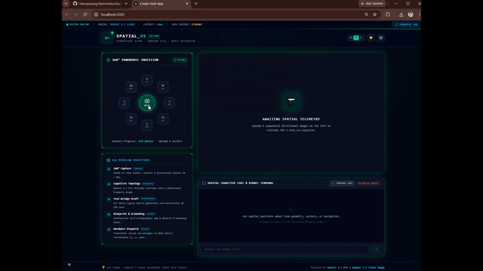

# 🌌 Spatial OS (GeminiSpace v4.0) — Vision-Language-Action Indoor Navigator

<div align="center">

[](https://cerebralvalley.ai/e/gemini-3-seoul-hackathon/hackathon/gallery?project=27)
[](https://blog.google/intl/ko-kr/company-news/inside-google/gemini-seoul-hackathon-first/)
[](https://www.youtube.com/watch?v=rZI6C7XsnY4)
[](https://fastapi.tiangolo.com)
[](https://nextjs.org)
[](https://ai.google.dev)
[](https://mincasurong.github.io)

<br />

<p align="center">
  
</p>

**An autonomous indoor spatial intelligence & robotics navigation SaaS operating system powered by Google Gemini 4 Argon & Gemini 3.8 Flash.**  
*Transforms 8 ordinary panoramic smartphone photos (`0:N` → `7:NW`) into Visual SLAM relational property graphs, deterministic Parametric CAD blueprints (SVG & AutoCAD R12 DXF), photorealistic 2D orthographic floor plans, 3D voxel digital twins, and ROS2 `Nav2_FollowWaypoints` robotic navigation trajectories.*

</div>

---

## 📑 Table of Contents

- [🏆 Hackathon Story & Origin](#-hackathon-story--origin)
- [💡 The Hard Tech Challenge](#-the-hard-tech-challenge)
- [🧠 The Core Breakthrough: 3-Step VLA Pipeline & Parametric CAD](#-the-core-breakthrough-3-step-vla-pipeline--parametric-cad)
- [🔬 Visual SLAM Keypoint Tracking & Anti-Hallucination](#-visual-slam-keypoint-tracking--anti-hallucination)
- [📐 Deterministic CAD Exporters (SVG, AutoCAD DXF, ROS2)](#-deterministic-cad-exporters-svg-autocad-dxf-ros2)
- [🤖 Physical Robotics & ROS2 Hardware Bridge](#-physical-robotics--ros2-hardware-bridge)
- [🖥️ SaaS User Flow, 5-Language i18n & 4 Viewport Subsystems](#️-saas-user-flow-5-language-i18n--4-viewport-subsystems)
- [🏗️ System Architecture](#️-system-architecture)
- [⚡ Gemini Models Allocation & Dual-Engine Resilience](#-gemini-models-allocation--dual-engine-resilience)
- [🚀 Quick Start Guide](#-quick-start-guide)
- [📡 API Reference](#-api-reference)
- [🧪 Automated Test Suite](#-automated-test-suite)
- [☁️ Google Cloud Run Deployment](#️-google-cloud-run-deployment)
- [📂 Repository Structure](#-repository-structure)
- [⚠️ Limits](#️-limits)
- [📜 License](#-license)

---

## 🏆 Hackathon Story & Origin

**GeminiSpace (Spatial OS)** was created during the **Gemini 3 Seoul Hackathon** on **February 28, 2026** (hosted by **Google DeepMind**, **Google AI Studio**, **Cerebral Valley**, and **AttentionX** in Seoul, Korea).

Competing against 111 advanced AI engineering teams, GeminiSpace won **1st Place in the Gemini in Hard Tech Track**, and has since evolved into **SPATIAL_OS v4.0 Cloud** with dual-engine Gemini 4 Argon / 3.8 Flash reasoning, deterministic CAD/DXF synthesis, multi-tenant persistence, and 5-language internationalization.

### 📰 Official Press & Links
* **Google Korea Official Blog Article:** [구글 블로그 인터뷰: "단 7시간 만에 혼자 구현하는 AI 공간 솔루션 완성"](https://blog.google/intl/ko-kr/company-news/inside-google/gemini-seoul-hackathon-first/)
* **Cerebral Valley Project Gallery:** [Project #27 — GeminiSpace (1st Place Winner)](https://cerebralvalley.ai/e/gemini-3-seoul-hackathon/hackathon/gallery?project=27)
* **YouTube Presentation & Demo:** [Watch the Live Hackathon Pitch on YouTube](https://www.youtube.com/watch?v=rZI6C7XsnY4)
* **Developer Portfolio:** [Developed by m9g (mincasurong.github.io)](https://mincasurong.github.io)

---

## 💡 The Hard Tech Challenge

In smart factories, warehouses, healthcare facilities, and construction sites, deploying Autonomous Mobile Robots (AMRs) requires spatial mapping. Traditional **LiDAR-based SLAM (Simultaneous Localization and Mapping)** suffers from severe bottlenecks:

1. **Expensive Hardware Requirements**: High-precision LiDAR sensors and depth cameras cost thousands of dollars per robot.
2. **Labor-Intensive Pre-Scanning**: Human technicians must manually drive teleoperated sensor rigs through every hallway and room to generate point clouds.
3. **Rigid & Non-Semantic**: Point clouds represent raw geometric density but lack semantic comprehension (they cannot tell a refrigerator from an exit door, or an obstacle from a chair).
4. **Computationally Heavy**: Real-time point-cloud registration requires significant onboard compute and battery power.

**The GeminiSpace Thesis:**  
*What if a human or robot could stand at the center of any room, capture 8 regular photos with a standard RGB camera, and have an AI instantly construct a metric 2D floor plan, a deterministic CAD blueprint, a 3D digital twin, a relational property graph, and executable ROS2 navigation waypoints in seconds?*

---

## 🧠 The Core Breakthrough: 3-Step VLA Pipeline & Parametric CAD

Feeding perspective camera photographs directly into 2D image generators causes severe **3D perspective distortions, hallucinated walls, and warped angles**. 

GeminiSpace solves this by combining **Step 1.5 Parametric CAD Pre-Synthesis** with the **Text-Bridge Architecture**, streamed live to the operator console via non-blocking Server-Sent Events (`/api/upload-node-stream`):

```mermaid
flowchart LR
    subgraph S1["Step 1: SLAM Topology"]
        P["8 Directional Photos\n(0:N → 7:NW)"] --> TOPO["Gemini 4 Argon / 3.8 Flash\n(SLAM Keypoints & Property Graph)"]
        TOPO --> CAD["Step 1.5: Parametric CAD\n(Polar Polygon, SVG & Initial BBoxes)"]
    end

    subgraph S2["Step 2: Text-Bridge Map Synthesis"]
        TOPO --> S2A["Step 2a: Layout Description\n(Gemini 3.8 Flash Material & Geometry Spec)"]
        S2A -->|"Text Only (No Photos)"| S2B["Step 2b: 2D Blueprint Render\n(Gemini 3.1 Flash Image / CAD SVG Fallback)"]
    end

    subgraph S3["Step 3: Object Localization"]
        S2B & CAD --> LOC["Step 3: Visual Grounding\n(Gemini 3.8 Flash Calibrated [0,100]% BBoxes)"]
    end

    LOC --> UI["Holographic HUD, 3D Twin, DXF & ROS2 Nav2"]

    style S1 fill:#0f172a,stroke:#00FF9D,stroke-width:2px
    style S2 fill:#0f172a,stroke:#38BDF8,stroke-width:2px
    style S3 fill:#0f172a,stroke:#A855F7,stroke-width:2px
```



1. **Step 1: Visual SLAM Topology Extraction (`extract_topology`)**:  
   Analyzes 8 directional photos taken sequentially at $45^\circ$ increments from the room center ($0^\circ\text{ N} \to 315^\circ\text{ NW}$). Uses `gemini-4-argon` (with automatic fallback to `gemini-3.8-flash`) to extract a **Relational Spatial Property Graph** (`SpatialNode`: `seam_keypoints`, `loop_closure`, `room_geometry`, `static_anchors`, `dynamic_objects`, `spatial_relations`, and `navigable_edges`).
2. **Step 1.5: Deterministic Parametric CAD Pre-Synthesis (`exporters.py`)**:  
   Immediately converts polar seam keypoint distances ($1.2\text{m}\text{--}5.0\text{m}$) into a closed `[8.0, 92.0]%` room polygon (`compute_polygon_from_keypoints`), computes initial bounding boxes (`derive_default_locations`), and streams a `1600x900` Parametric CAD SVG data URL to the frontend before image synthesis even begins.
3. **Step 2a: Material & Geometric Layout Text-Bridge (`extract_layout_description`)**:  
   Translates the source photos and topological property graph into a **purely textual architectural CAD specification** (`gemini-3.8-flash`), capturing floor finishes (*polished grey marble tiles, parquet oak*), wall materials (*brushed metal, travertine stone*), and metric clearances.
4. **Step 2b: Photorealistic 2D Floor Plan Synthesis (`generate_birds_eye_view`)**:  
   Sends the **text-only** layout description (never raw perspective photos) to `gemini-3.1-flash-image` (with automatic fallback to `gemini-3.8-flash` and the Step 1.5 Parametric CAD SVG), generating a **16:9 orthographic 2D top-down floor plan rendering** with zero 3D perspective distortion.
5. **Step 3: Calibrated Visual Grounding (`locate_objects_in_map`)**:  
   Correlates the 2D blueprint with every static anchor and dynamic object using `gemini-3.8-flash` (`thinking_budget=512`), automatically normalizing `[0, 1000]` scale outputs to `[0.0, 100.0]%` bounding boxes (`ymin`, `xmin`, `ymax`, `xmax`) and syncing calibrated coordinates back into the room topology.

---

## 🔬 Visual SLAM Keypoint Tracking & Anti-Hallucination

To prevent spatial drift and hallucinated walls, GeminiSpace implements **Visual SLAM Seam Keypoint Tracking** and a **3-Tier Localization Guarantee**:

* **Adjacent Overlap Seam Matching**: Adjacent photos share $\sim 25\text{--}35\%$ field-of-view overlap. The pipeline extracts invariant geometric keypoints across all 8 consecutive view pairs:
  $$\text{Seams: } [0, 1] \to [1, 2] \to [2, 3] \to [3, 4] \to [4, 5] \to [5, 6] \to [6, 7] \to [7, 0]$$
* **$360^\circ$ Loop Closure Constraint**: Image 7 (`NW`: $315^\circ$) and Image 0 (`N`: $0^\circ$) are matched to enforce closed-loop perimeter alignment without angular drift.
* **3-Tier 100% Object Placement Guarantee**:
  1. **Tier 1**: Step 3 visual grounding on the synthesized 2D blueprint (`locate_objects_in_map`).
  2. **Tier 2**: Step 1 `bbox` coordinates extracted during topology analysis (`derive_default_locations`).
  3. **Tier 3**: Polar projection from `associated_keypoint_ids` (`dist_m`) or 8-sector compass fallback (`DIRECTION_PRESETS`, `0:N`..`7:NW`) with deterministic index jitter.

---

## 📐 Deterministic CAD Exporters (SVG, AutoCAD DXF, ROS2)

All spatial representations share a unified `[0.0, 100.0]%` normalized coordinate frame (`(0,0)` top-left, `(100,100)` bottom-right) and can be exported on demand from `backend/exporters.py`:

* **Parametric CAD SVG (`GET /api/workspaces/{ws}/nodes/{node}/export/svg`)**: Scales `[0, 100]%` to a `1600x900` viewBox (`x * 16.0`, `y * 9.0`), rendering room perimeter polygons, compass sector rays, keypoint rings, static anchors, and dynamic objects.
* **AutoCAD R12 (`AC1009`) 3D DXF (`GET /api/workspaces/{ws}/nodes/{node}/export/dxf`)**: Scales percentages by `0.1` ($10\text{m} \times 10\text{m}$ metric room) and flips the Y-axis ($y_m = (100.0 - y_{\text{pct}}) \times 0.1$) across 4 layers: `WALLS` (3D `LINE` entities extruded from $z=0.0\text{m}$ to $z=2.8\text{m}$), `STATIC_ANCHORS`, `DYNAMIC_OBJECTS`, and `LABELS`.
* **ROS2 `Nav2_FollowWaypoints` Mission JSON (`GET /api/workspaces/{ws}/nodes/{node}/export/ros2`)**: Exports metric `geometry_msgs/PoseStamped` waypoints with heading quaternions $(q_z, q_w)$ computed radially from the room center $(5.0\text{m}, 5.0\text{m})$.

---

## 🤖 Physical Robotics & ROS2 Hardware Bridge

GeminiSpace converts high-level cognitive understanding into physical robotic motion.

### Metric Coordinate Mapping
Bounding box percentage coordinates $[0.0 - 100.0\%]$ on the orthographic 2D map are mapped to metric space in the robot's `map` coordinate frame ($1\% = 0.1\text{m}$, representing a $10\text{m} \times 10\text{m}$ normalized local room bounding box):

$$X_{\text{metric}} = \left(\frac{x_{\min} + x_{\max}}{2}\right) \times 0.1 \quad [\text{meters}]$$

$$Y_{\text{metric}} = \left(\frac{y_{\min} + y_{\max}}{2}\right) \times 0.1 \quad [\text{meters}]$$

### ROS2 Nav2 Action Dispatch Payload
When a destination is clicked in the 2D map or planned across rooms, GeminiSpace serializes the coordinates into a standard **`geometry_msgs/PoseStamped`** array and dispatches it to the ROS2 Nav2 Action Server:

```json
{
  "action": "Nav2_FollowWaypoints",
  "frame_id": "map",
  "node_name": "Building Elevator Lobby and Stairwell",
  "waypoints": [
    {
      "header": { "frame_id": "map", "stamp": { "sec": 1772496000, "nanosec": 0 } },
      "pose": {
        "position": { "x": 5.00, "y": 2.10, "z": 0.0 },
        "orientation": { "x": 0.0, "y": 0.0, "z": 0.0, "w": 1.0 }
      }
    }
  ]
}
```

---

## 🖥️ SaaS User Flow, 5-Language i18n & 4 Viewport Subsystems

### 4-Stage Progressive Onboarding & Internationalization (`EN` / `KO` / `JA` / `ZH` / `ES`)
The frontend provides a progressive 4-stage workflow with instant language switching across **English (default)**, **Korean**, **Japanese**, **Chinese**, and **Spanish**:
1. **Stage 1 — Opening Landing (`OpeningLandingPage.tsx`)**: Holographic spatial overview and system entry.
2. **Stage 2 — 1-Click Google OAuth (`GoogleAuthGateModal.tsx`)**: Instant Google account chooser authentication backed by Cloud Firestore & SQLite session sync.
3. **Stage 3 — Architecture Walkthrough (`ScholarIntroOverlay.tsx`)**: Interactive briefing on the 3-step VLA pipeline, SLAM loop closure, and ROS2 bridge.
4. **Stage 4 — Holographic Spatial HUD Cockpit (`page.tsx`)**: Operator console with Bento KPI telemetry, `DIRECTIVES` (360° upload + AI chat/planner) and `INSPECTOR` (entity telemetry + CAD/ROS2 exports) tabs.

### 4 Synchronized Cockpit Viewports
1. **🗺️ 2D Blueprint (`MAP` — `InteriorMapComponent.tsx`)**:
   * Shared aspect-ratio-locked coordinate frame (`naturalWidth / naturalHeight`) aligning the AI-rendered blueprint, Parametric CAD SVG, `<svg>` metric grid, and `[0, 100]%` bounding boxes without letterbox drift.
   * Persistent HUD badges on every anchor and dynamic object, source camera photo inspector (`0:N`..`7:NW`), and 1-click ROS2 `Nav2_FollowWaypoints` dispatch.
2. **🧊 3D Digital Twin (`TWIN` — `DigitalTwin.tsx`)**:
   * Full-viewport (`620px`) Three.js (`@react-three/fiber`) voxel scene (`22m × 13.5m` floor footprint) with instant local lighting (`<hemisphereLight>`, `<pointLight>`, `<Grid>`).
   * Brightness-inverted `InstancedMesh` floor plan extrusion (`128×72` grid), `2.6m` translucent cyan parametric perimeter walls, 3D entity volumes with floating HUD labels, and **`3D FIT SCREEN`** / **`TOP-DOWN 90°`** camera presets.
3. **🔗 SLAM Graph (`GRAPH` — `SemanticGraph.tsx`)**:
   * `@xyflow/react` v12 concentric radial property graph (`620px` canvas) with SLAM summary HUD bar, `<MiniMap>`, concentric guide rings, central room hub, static anchors ($r=155$), seam keypoints + $360^\circ$ loop-closure ring ($r=270$), and dynamic objects ($r=380$).
4. **🌐 Multi-Room Fleet (`FLEET` — `GraphVisualizerComponent.tsx`)**:
   * `@xyflow/react` v12 topological graph visualizing both scanned room hubs and radial **Navigable Exit Portals** (`elevator_entry [N]`, `reception_entry [E]`, `stairs_up [SW]`, `stairs_down [S]`) with animated directional edges and visibility-aware 5s polling.
5. **🎓 Standalone Showcase Laboratory (`/scholar` — `app/scholar/page.tsx`)**:
   * Self-contained offline showcase with pre-generated lobby topology, interactive blueprint simulation, live ROS2 payload inspector, and automated VLA Q&A playback.

---

## 🏗️ System Architecture

```
┌─────────────────────────────────────────────────────────────────────────┐
│  Presentation Layer: Next.js 16 (Static Export) + React 19 + Tailwind 4 │
│  ├── 🌐 4-Stage Progressive Flow (Opening → OAuth → Intro → Cockpit)    │
│  ├── 🗣️ 5-Language i18n (EN / KO / JA / ZH / ES)                        │
│  ├── 🗺️ 2D Blueprint (Aspect-Locked BBoxes, CAD SVG Toggle, ROS2 Nav2)  │
│  ├── 🧊 Three.js 3D Voxel Digital Twin (22m×13.5m Floor + Fit Presets)  │
│  ├── 🔗 ReactFlow v12 Radial SLAM Graph & Multi-Room Exit Portal Graph  │
│  └── 🎓 /scholar — Standalone Offline Showcase & VLA Q&A Simulator      │
└────────────────────────────────────┬────────────────────────────────────┘
                                     │ REST & SSE (/api/*)
                                     ▼
┌─────────────────────────────────────────────────────────────────────────┐
│  Backend Orchestration Layer: FastAPI 4.0 + NetworkX + SQLite WAL       │
│  ├── POST /api/upload-node-stream ──► Non-Blocking Async SSE Pipeline   │
│  ├── POST /api/upload-node        ──► Synchronous VLA Pipeline          │
│  ├── POST /api/chat               ──► Multimodal Spatial Q&A            │
│  ├── POST /api/query-planner      ──► Multi-Room Trajectory Router      │
│  ├── GET  /api/graph              ──► Session & Workspace Topology      │
│  ├── GET  /api/workspaces/{ws}/nodes/{n}/export/{svg|dxf|ros2}          │
│  └── WorkspaceStore (SQLite WAL + NetworkX DiGraph + Cloud Firestore)   │
└────────────────────────────────────┬────────────────────────────────────┘
                                     │ Google GenAI SDK (google-genai)
                                     ▼
┌─────────────────────────────────────────────────────────────────────────┐
│  Cognitive VLA Brain: Dual-Engine Google Gemini API                     │
│  ├── Step 1:   SLAM Topology Extraction ──► gemini-4-argon (→3.8-flash) │
│  ├── Step 1.5: Parametric CAD & Polygon ──► Deterministic Math (No LLM) │
│  ├── Step 2a:  Layout Text-Bridge       ──► gemini-3.8-flash            │
│  ├── Step 2b:  2D Blueprint Synthesis   ──► gemini-3.1-flash-image      │
│  ├── Step 3:   Calibrated Grounding     ──► gemini-3.8-flash            │
│  └── Chat / Trajectory Planner          ──► gemini-4-argon (→3.8-flash) │
└────────────────────────────────────┬────────────────────────────────────┘
                                     │ ROS2 Action / CAD Export
                                     ▼
┌─────────────────────────────────────────────────────────────────────────┐
│  Hardware & CAD Layer: ROS2 Nav2 FollowWaypoints / AutoCAD R12 DXF      │
└─────────────────────────────────────────────────────────────────────────┘
```

---

## ⚡ Gemini Models Allocation & Dual-Engine Resilience

Configured centrally in `backend/model_config.py`, `VLAService._generate_content` provides **Dual-Engine Resilience**: Pro-tier steps default to **`gemini-4-argon`** and transparently fall back to **`gemini-3.8-flash`** if preview entitlement, regional availability, or quota limits are encountered. All synchronous SDK calls run off the event loop via `asyncio.to_thread`.

| Pipeline Step | Primary Model | Automatic Fallback | Role Description |
| :--- | :--- | :--- | :--- |
| **Step 1: Topology Extraction** | `gemini-4-argon` | `gemini-3.8-flash` | 360° SLAM seam keypoints (`thinking_budget=1024`), loop closure & property graph |
| **Step 1.5: Parametric CAD** | Deterministic Math | — | Polar-to-polygon synthesis, initial bboxes & instant `1600x900` CAD SVG |
| **Step 2a: Layout Text-Bridge** | `gemini-3.8-flash` | — | Material extraction, floor textures & keypoint-anchored geometric specification |
| **Step 2b: 2D Blueprint Render** | `gemini-3.1-flash-image` | `gemini-3.8-flash` → CAD SVG | Photorealistic 16:9 orthographic 2D top-down floor plan rendering (text-only input) |
| **Step 3: Map Grounding** | `gemini-3.8-flash` | Tier 2/3 Parametric BBoxes | `[0, 100]%` bounding box grounding (`thinking_budget=512`, `[0,1000]` scale normalization) |
| **Spatial Reasoning Chat** | `gemini-4-argon` | `gemini-3.8-flash` | Multimodal environmental Q&A grounded in photos, blueprint & property graph |
| **Trajectory Planner** | `gemini-4-argon` | `gemini-3.8-flash` | Goal-driven multi-room path planning and exit traversal |

---

## 🚀 Quick Start Guide

### Prerequisites
* Python 3.11+
* Node.js 20+
* A [Google AI Studio](https://aistudio.google.com/) API Key (`GOOGLE_API_KEY`)

### 1. Clone the Repository
```bash
git clone https://github.com/mincasurong/GeminiSeoulHackathon2026.git
cd GeminiSeoulHackathon2026
```

### 2. Configure API Key
Create a `.env` file in `backend/`:
```bash
echo GOOGLE_API_KEY=your_gemini_api_key_here > backend/.env
```

### 3. Start the Backend Server (Terminal 1)
```bash
pip install -r backend/requirements.txt
python backend/main.py
```
Backend runs on **http://localhost:8000** (Swagger API Docs at `/docs`, health probes at `/health` and `/healthz`).

### 4. Start the Frontend Dashboard (Terminal 2)
```bash
cd frontend
npm ci
npm run dev
```
Frontend runs on **http://localhost:3000**.  
Standalone Showcase Laboratory is at **http://localhost:3000/scholar**.

---

## 📡 API Reference

### `POST /api/upload-node-stream` (SSE) & `POST /api/upload-node`
Runs the 3-step VLA pipeline from 8 multipart directional photos (`0:N` $\to$ `7:NW`).
* **Form Parameters**:
  * `node_name` (`string`): Room or zone identifier.
  * `images` (`List[UploadFile]`): 8 directional photos in clockwise order (`0:N` $\to$ `7:NW`).
  * `engine` (`string`, default `"gemini"`): Engine selector (`"gemini-4-argon"` or `"gemini-3.8-flash"`).
  * `workspace_id` (`string`, default `"default"`): Multi-tenant workspace ID.
* **Response**: Streams step progress events (`step 1` $\to$ `step 2` with immediate `parametric_svg` $\to$ `step 3` complete payload) or returns `UploadNodeResponse` (topology, map image data URL, parametric CAD SVG, and calibrated object bounding boxes).

### `POST /api/chat`
Performs multimodal spatial reasoning grounded in the active room's topology, blueprint, and source photographs.
* **Payload**:
  ```json
  {
    "query": "Where is the nearest exit to the staircase?",
    "node_name": "Building Elevator Lobby and Stairwell",
    "history": [],
    "engine": "gemini-3.8-flash"
  }
  ```

### `POST /api/query-planner`
Plans a multi-room navigation trajectory and generates a ROS2 `Nav2_FollowWaypoints` mission payload.
* **Payload**:
  ```json
  {
    "user_query": "Navigate to the reception desk",
    "current_node": "Building Elevator Lobby and Stairwell",
    "engine": "gemini-3.8-flash"
  }
  ```

### `GET /api/workspaces/{workspace_id}/nodes/{node_name}/export/{format}`
Exports deterministic spatial artifacts for the specified room:
* `format = svg`: `image/svg+xml` (`1600x900` Parametric CAD blueprint).
* `format = dxf`: `application/dxf` (AutoCAD R12 `AC1009` 3D DXF with `2.8m` extruded walls).
* `format = ros2`: `application/json` (ROS2 `Nav2_FollowWaypoints` mission).

---

## 🧪 Automated Test Suite

The backend includes a comprehensive **`pytest`** suite covering API routes, health probes, Pydantic coordinate coercion, JSON sanitization fences, `[0, 1000]` $\to$ `[0, 100]%` bounding box normalization, and directional fallback presets:

```bash
python -m pytest backend/tests -v
```

```text
============================= test session starts =============================
collected 20 items

backend/tests/test_api.py ......                                         [ 30%]
backend/tests/test_models.py .......                                     [ 65%]
backend/tests/test_vla_service.py .......                                [100%]

============================= 20 passed in 4.36s ==============================
```

---

## ☁️ Google Cloud Run Deployment

The root multi-stage `Dockerfile` compiles the Next.js 16 static export (`frontend/out`) in Stage 1 (`node:20-alpine`) and mounts it directly onto FastAPI in Stage 2 (`python:3.11-slim`, `PORT=8080`), serving both the UI (`/`, `/scholar`) and REST/SSE API (`/api/*`, `/health`, `/healthz`) from a single unified container:

```bash
# Build and run the unified production container locally
docker build -t spatial-os .
docker run -p 8080:8080 -e GOOGLE_API_KEY="your_key" spatial-os

# Deploy directly from source to Google Cloud Run
gcloud run deploy geminispace-app \
  --source . \
  --region asia-northeast3 \
  --allow-unauthenticated \
  --memory 2Gi \
  --cpu 2 \
  --timeout 600
```

---

## 📂 Repository Structure

```
GeminiSeoulHackathon2026/
├── backend/                    # FastAPI v4.0 server, VLA pipeline & WorkspaceStore
│   ├── main.py                 # REST/SSE routes (/api/*, /health, /healthz) & static SPA mount
│   ├── vla_service.py          # VLAService: Dual-Engine Gemini 4 Argon / 3.8 Flash orchestrator
│   ├── prompts.py              # Structured VLA system instructions & prompt builders
│   ├── exporters.py            # Parametric polygon math & SVG, AutoCAD R12 DXF, ROS2 exporters
│   ├── storage.py              # SQLite WAL WorkspaceStore, SaaS metering & Cloud Firestore sync
│   ├── models.py               # Pydantic v2 SLAM, workspace & API schemas with defensive coercers
│   ├── model_config.py         # Centralized Gemini 4 Argon & 3.8 Flash model configuration
│   ├── requirements.txt        # Python dependencies
│   └── tests/                  # 20 automated pytest unit & integration tests
├── frontend/                   # Next.js 16 (App Router, static export) + React 19 + Tailwind v4
│   ├── app/
│   │   ├── page.tsx            # 4-stage SaaS controller & 4-mode (MAP/TWIN/GRAPH/FLEET) cockpit
│   │   ├── globals.css         # Holographic Spatial HUD styling tokens (#00FF9D / #38BDF8)
│   │   ├── scholar/            # Standalone offline showcase & simulated VLA Q&A terminal
│   │   ├── components/         # 2D Map, 3D Voxel Twin, ReactFlow SLAM/Fleet graphs, OAuth & HUD
│   │   └── lib/                # Centralized API client (api.ts), workspace hook & i18n dictionary
│   └── public/                 # Pre-seeded lobby topology.json & calibrated default_blueprint.png
├── design-system/              # Persisted Holographic Spatial HUD design system (MASTER.md)
├── .agents/                    # Project-local agent rules & specialized engineering skills
├── .github/workflows/ci.yml    # GitHub Actions CI: backend pytest + frontend static build
├── Dockerfile                  # Unified multi-stage Cloud Run build (Node 20 -> Python 3.11)
├── .dockerignore               # Excludes node_modules, .next, .venv, .git, and local DBs
└── README.md                   # Project overview & documentation
```

---

## ⚠️ Limits

- Room scale is normalized to $10\text{m} \times 10\text{m}$ ($1\% = 0.1\text{m}$) rather than LiDAR metric rangefinding.
- Visual SLAM keypoints are VLM-extracted semantic/geometric landmarks across adjacent overlaps rather than a dense point-cloud frontend.
- ROS2 integration dispatches `Nav2_FollowWaypoints` action payloads (`geometry_msgs/PoseStamped`) rather than a hardware motor driver.
- The Text-Bridge passes text-only layout specifications to the image synthesizer to eliminate perspective warp; deterministic geometry is provided by the companion Parametric CAD SVG/DXF exporters.

---

## 📜 License

Distributed under the **MIT License**. Created by **[m9g](https://mincasurong.github.io)** for the **Google Gemini 3 Seoul Hackathon (February 28, 2026)**.
